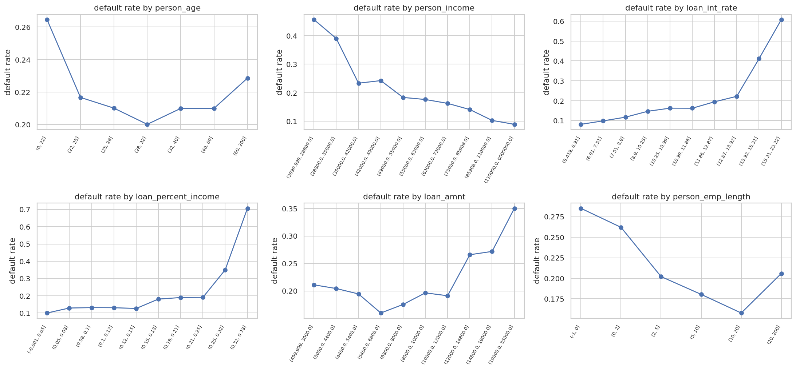
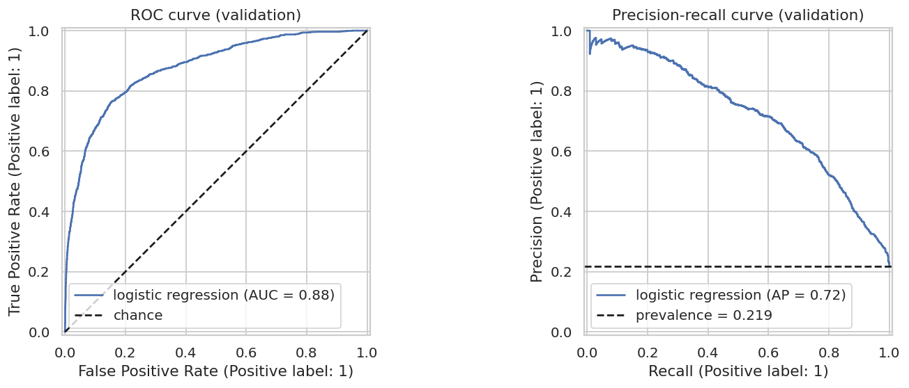
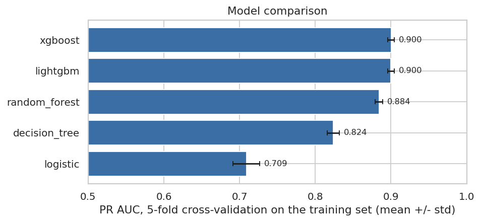
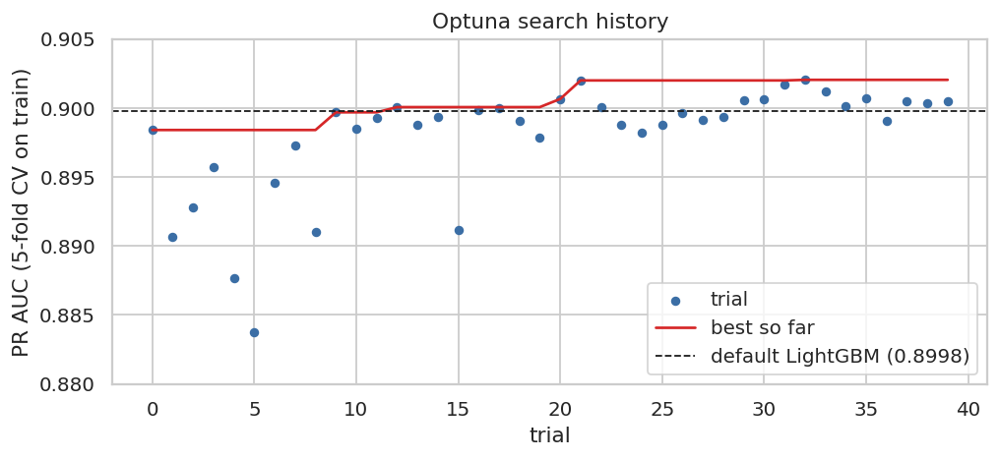
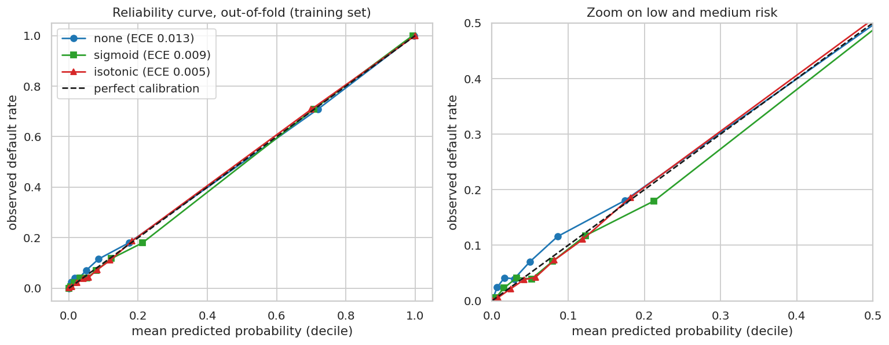
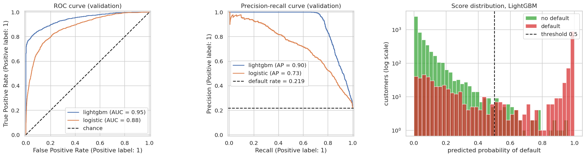

# Credit Risk Scoring

End-to-end credit risk scoring project: exploratory analysis, modeling, probability calibration, SHAP explainability, fairness check, and deployment with FastAPI and Docker.

> 🇫🇷 Version française : [README.fr.md](README.fr.md)

**Status:** 🚧 work in progress. Progress is tracked in the [Issues](../../issues) and [Milestones](../../milestones).

## Business problem

A lender must decide whether to grant a loan. Two errors are possible:

- **False negative** (loan granted, borrower defaults): the lender loses part of the principal. Assumed loss given default (LGD): **60% of the loan amount**.
- **False positive** (good customer refused): the lender loses the expected interest income, approximated by **loan_amnt × loan_int_rate** (one-year proxy).

With the average interest rate in the data, a missed default costs roughly **5 times** more than a wrongly refused customer. Because these assumptions are debatable, results are also reported for other cost ratios (3:1, 5:1, 10:1).

**Goal:** predict the probability of default, then choose the decision threshold that minimizes the expected total cost.

**Metrics:** AUC-PR and KS (ranking quality), Brier score (calibration), expected cost (business impact). Accuracy is not used: a naive model that always predicts "no default" already reaches about 78%.

## Dataset

[Credit Risk Dataset](https://www.kaggle.com/datasets/laotse/credit-risk-dataset) (Kaggle). The raw data is not versioned: download it and place the CSV in `data/raw/`.

## Data insights

Exploratory analysis on the training set only (full notebook: [`notebooks/01_eda.ipynb`](notebooks/01_eda.ipynb)). The dataset has 32,581 rows; 165 exact duplicates were removed before the stratified 60/20/20 split (21.9% defaults in each part).

- **Strong, non-linear signals:** `loan_grade` (10% default in grade A, 60% in grade D), `loan_int_rate`, `loan_percent_income` (sharp rise above 0.25) and `person_income`.
- **Grade and interest rate overlap heavily** (median rate 7.5% in grade A, 20.1% in grade G), hence a dedicated with/without `loan_grade` study.
- **Data quality:** implausible values (ages up to 144, employment length up to 123 years), 9.5% of `loan_int_rate` and 2.8% of `person_emp_length` missing. Missing employment length goes with a higher default rate (31.2% versus 21.6%).

- **Data artifact (target leakage):** in the training set, the provided `loan_percent_income` differs from `loan_amnt / person_income` on 211 rows (1.1%), and **all of them are defaults**. The model therefore uses the recomputed ratio `loan_to_income` instead (see below).



## Data cleaning decisions

Decided from the training-set analysis; the deterministic rule is in [`src/data/clean.py`](src/data/clean.py), the imputations are learned inside the preprocessing pipeline so that nothing leaks from validation or test data.

| Topic | Decision | Implemented in |
|---|---|---|
| Age above 100, employment length above 60 | Rows removed with the same rule on train, validation and test (6, 1 and 0 rows). The API rejects such inputs. | `src/data/clean.py` |
| Income above 1,000,000 | Kept; log-transform or robust scaling for linear models | preprocessing pipeline |
| Missing `person_emp_length` | Median imputation plus a missing-value indicator (31.2% default rate when missing versus 21.6%) | preprocessing pipeline |
| Missing `loan_int_rate` | Median imputation by `loan_grade`, fitted on train | preprocessing pipeline |
| `loan_percent_income` | Replaced by the recomputed ratio `loan_to_income`: the provided ratio differs on 1.1% of training rows, all defaults (a leakage artifact of the dataset). Those rows are kept, not deleted. | `src/features/engineering.py` |
| `loan_grade` | Kept; compared with and without | dedicated study |

## Model comparison

Metrics on the **validation set** (single split, no confidence interval yet). Recall and precision are given at a threshold of 0.5 only as a reference; the cost-optimal threshold is chosen later. Full table: [`reports/model_comparison.csv`](reports/model_comparison.csv).

| Model | ROC AUC | PR AUC | KS | Brier | Recall | Precision |
|---|---|---|---|---|---|---|
| constant prior (no model) | 0.500 | 0.219 | 0.000 | 0.171 | 0.000 | 0.000 |
| logistic regression (baseline) | 0.877 | 0.723 | 0.611 | 0.104 | 0.544 | 0.741 |
| logistic + `loan_to_income` (replaces `loan_percent_income`) | 0.878 | 0.726 | 0.609 | 0.103 | 0.550 | 0.744 |
| LightGBM (default settings) | 0.946 | 0.905 | 0.759 | 0.051 | 0.752 | 0.954 |
| LightGBM (tuned, not adopted) | 0.948 | 0.907 | 0.765 | 0.051 | 0.750 | 0.966 |

Feature selection was cross-validated on the training set only (5 folds, logistic regression and gradient boosting). Of four candidate features, only the recomputed ratio replacing the provided one was kept; adding it next to the provided ratio would have let the model read the leak above (details in [`notebooks/02_modeling_experiments.ipynb`](notebooks/02_modeling_experiments.ipynb), section 3). The differences between the two logistic models are small and come from a single validation split.



### Cross-validation on the training set (issue #10)

5-fold stratified cross-validation, mean ± standard deviation across folds, same folds for every model, near-default hyperparameters (no tuning, no class weights) and the features selected above. Full table: [`reports/cv_comparison.csv`](reports/cv_comparison.csv).

| Model | PR AUC | ROC AUC | KS | Brier |
|---|---|---|---|---|
| XGBoost | 0.900 ± 0.004 | 0.946 ± 0.002 | 0.750 ± 0.008 | 0.054 ± 0.002 |
| LightGBM | 0.900 ± 0.004 | 0.944 ± 0.001 | 0.752 ± 0.012 | 0.054 ± 0.002 |
| Random Forest | 0.884 ± 0.005 | 0.932 ± 0.002 | 0.735 ± 0.015 | 0.059 ± 0.002 |
| decision tree (depth 5, diagnostic) | 0.824 ± 0.008 | 0.892 ± 0.005 | 0.679 ± 0.015 | 0.067 ± 0.003 |
| logistic regression | 0.709 ± 0.018 | 0.867 ± 0.008 | 0.583 ± 0.017 | 0.107 ± 0.003 |



XGBoost and LightGBM are equivalent (paired PR AUC difference +0.0002, standard deviation 0.0018); **LightGBM was chosen** because it fits slightly faster, and XGBoost stays an alternative to revisit at tuning time. Both beat the logistic regression on every fold. Re-running the tree models with the original features (including the leaky ratio) changed nothing meaningful, so the trees do not exploit that artifact. These scores are very high for credit scoring and probably reflect how this public dataset was built (see Limitations). The LightGBM row in the validation table above is a single evaluation on the validation set; recall and precision are at the 0.5 reference threshold.

### Class imbalance (issue #11)

Class weights (`balanced`) and SMOTE-NC (1:1, applied only to the training part of each fold) were compared with the unweighted models, by 5-fold cross-validation on the training set. Full table: [`reports/imbalance_comparison.csv`](reports/imbalance_comparison.csv).

| Model | Strategy | PR AUC | Brier | Mean predicted probability | Recall at 0.5 | Precision at 0.5 |
|---|---|---|---|---|---|---|
| LightGBM | none | 0.900 | 0.054 | 0.208 | 0.731 | 0.957 |
| LightGBM | class weights | 0.897 | 0.061 | 0.260 | 0.771 | 0.862 |
| LightGBM | SMOTE-NC | 0.897 | 0.055 | 0.215 | 0.733 | 0.943 |
| Logistic regression | none | 0.709 | 0.107 | 0.219 | 0.517 | 0.747 |
| Logistic regression | class weights | 0.704 | 0.146 | 0.384 | 0.787 | 0.512 |
| Logistic regression | SMOTE-NC | 0.701 | 0.141 | 0.366 | 0.768 | 0.526 |

The default rate is 21.9%. Neither strategy improves the ranking quality (PR AUC is lower, with no fold improving) and both degrade the probabilities (Brier score, mean predicted probability). They only move the operating point at the 0.5 threshold: an unweighted LightGBM reaches the same recall as the class-weighted one (0.771) with a threshold of 0.31 and a better precision (0.874 versus 0.862). **The models therefore stay unweighted**; the imbalance is handled by probability calibration and by a cost-based decision threshold (later issues). Class weighting was also offered to the hyperparameter search (see below); XGBoost was not tested.

### Hyperparameter tuning (issue #13)

Optuna search for the chosen LightGBM: 40 trials (seeded TPE sampler, first trial close to the default configuration), objective = mean PR AUC of the same 5 folds of the training set. Script: [`scripts/tune_lightgbm.py`](scripts/tune_lightgbm.py); results in [`reports/tuning/`](reports/tuning/). Search space: number of trees (100 to 600), learning rate (0.02 to 0.2), leaves (8 to 96), minimum samples per leaf (5 to 80), row and column subsampling, L1/L2 regularization and class weights.

| | PR AUC |
|---|---|
| default LightGBM (cross-validation, same folds) | 0.8998 |
| best trial of the search (same folds) | 0.9020 |
| paired gain on fresh folds (seeds 7 and 123) | +0.0021 and +0.0021 (noise 0.0035 and 0.0038) |
| validation set, default / tuned | 0.9049 / 0.9071 |

The 8 best trials form a plateau (0.9006 to 0.9020), and the best of 40 is optimistically biased, so the gain was measured again on folds the search had not used: +0.0021, smaller than the standard deviation of the paired differences. By the adoption rule used throughout the project, **the default LightGBM is kept**; the tuned parameters stay saved in [`reports/tuning/lightgbm_best_params.json`](reports/tuning/lightgbm_best_params.json). Hyperparameters matter little on this dataset. The validation set was used a second time, for these two models only.



### Probability calibration (issue #14)

Sigmoid (Platt) and isotonic calibration were compared with the uncalibrated LightGBM, by 5-fold cross-validation on the training set; the calibrator is learned on out-of-fold predictions of the base model, so the whole procedure is evaluated on rows it never saw. Full table: [`reports/calibration_comparison.csv`](reports/calibration_comparison.csv).

| Calibration | Brier | Log loss | ECE | Mean predicted | PR AUC |
|---|---|---|---|---|---|
| none (reference) | 0.0540 ± 0.0022 | 0.1955 ± 0.0049 | 0.0137 ± 0.0020 | 0.208 | 0.8998 ± 0.0043 |
| sigmoid | 0.0540 ± 0.0020 | 0.1938 ± 0.0046 | 0.0109 ± 0.0023 | 0.222 | 0.8998 ± 0.0043 |
| isotonic | 0.0538 ± 0.0018 | 0.1926 ± 0.0061 | 0.0102 ± 0.0012 | 0.222 | 0.8926 ± 0.0048 |

The default rate is 0.219. The uncalibrated model is already reasonably calibrated, and **no calibrator improves the Brier score beyond noise**; isotonic regression has the lowest ECE but lowers the PR AUC by 0.007 on every fold. The sigmoid improves the log loss slightly in cross-validation but not on the validation set, and it corrects some probability ranges while over-correcting others. **No calibrator is applied.** One thing to keep in mind: the model under-estimates low risks (about 0.6% predicted for 1.5% observed in the lowest band), so its output is best read as a good risk score with approximate levels.



### Evaluation of the final model (issue #15)

Final model (default LightGBM, no calibrator) fitted on the training set and evaluated on the **validation set** (6,482 customers, 1,418 defaults), with 95% bootstrap intervals (1,000 resamples; both models are scored on the same resampled rows, so the difference has a paired interval). Full tables: [`reports/validation_evaluation.csv`](reports/validation_evaluation.csv) and [`reports/validation_differences.csv`](reports/validation_differences.csv). The test set has not been used.

| Metric | LightGBM [95% CI] | Logistic regression [95% CI] | Difference [95% CI] |
|---|---|---|---|
| ROC AUC | 0.946 [0.938, 0.953] | 0.878 [0.867, 0.887] | +0.068 [+0.060, +0.077] |
| PR AUC | 0.905 [0.893, 0.915] | 0.726 [0.702, 0.747] | +0.179 [+0.161, +0.198] |
| KS | 0.759 [0.741, 0.781] | 0.609 [0.589, 0.635] | +0.151 [+0.128, +0.172] |
| Brier score (lower is better) | 0.0514 [0.0472, 0.0559] | 0.1029 [0.0985, 0.1083] | -0.0516 [-0.0553, -0.0478] |
| Recall at 0.5 | 0.752 [0.730, 0.774] | 0.550 [0.524, 0.575] | +0.202 [+0.178, +0.228] |
| Precision at 0.5 | 0.954 [0.941, 0.966] | 0.744 [0.715, 0.770] | +0.211 [+0.185, +0.237] |
| Precision at 80% recall | 0.834 [0.776, 0.888] | 0.524 [0.496, 0.564] | +0.310 [+0.258, +0.351] |

At the 0.5 reference threshold, 1,067 of the 1,418 defaults are caught and 351 are missed, while 51 of the 5,064 good customers are refused (1.0%). Since a missed default is assumed to cost about five times more than a refused good customer, a lower threshold will probably be cheaper; it is chosen from the cost matrix in a later issue. LightGBM is ahead of the logistic regression on every metric in all 1,000 resamples.



## Key results

_To be completed at the end of the project (AUC-ROC, AUC-PR, KS, estimated financial impact)._

## Project structure

```
credit-risk-scoring/
├── data/            # raw and processed data (not versioned)
├── docs/            # data dictionary, model card
├── models/          # serialized models (not versioned)
├── notebooks/       # 01_eda, 02_modeling_experiments, 03_evaluation_explainability
├── reports/figures/ # figures used in the README
├── scripts/         # helper scripts (data inspection, etc.)
├── src/
│   ├── data/        # loading, splitting and cleaning
│   ├── features/    # preprocessing and feature engineering
│   ├── models/      # training, evaluation, threshold
│   └── api/         # FastAPI service
└── tests/
```

## Getting started

```bash
python -m venv .venv                # or: conda create -n credit-risk python=3.12
source .venv/bin/activate           # Windows PowerShell: .venv\Scripts\Activate.ps1
python -m pip install -r requirements.txt
python -m pytest -q                 # no test needs the dataset
```

To reproduce the notebooks, download the dataset into `data/raw/` (see above) and run `notebooks/01_eda.ipynb`, then `notebooks/02_modeling_experiments.ipynb`. `make install` and `make test` do the same on systems with `make`.

## Limitations

- **The dataset looks synthetic.** A construction artifact is documented above (a ratio that differs only on defaults), and the scores are very high (ROC AUC around 0.95). Such performance should not be expected on a real portfolio.
- **No temporal information:** no out-of-time validation is possible. Validation numbers come from a single stratified split; cross-validation on the training set gives a spread across folds, not an external check.
- **The validation set has been used for several model comparisons**, so its confidence intervals reflect sampling noise only and not selection optimism. The test set, untouched so far, will give the final unbiased estimate.
- **Cost assumptions** (loss given default of 60%) are assumptions; the decision threshold is not optimized yet.
- **Probabilities are reasonably calibrated but not exact:** low risks are under-estimated (about 0.6% predicted for 1.5% observed in the lowest band). Calibration, class weights, SMOTE and hyperparameter tuning were tested and not kept. Fairness has not been analyzed yet.

## License

MIT
